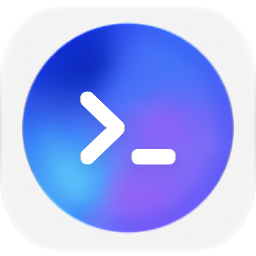
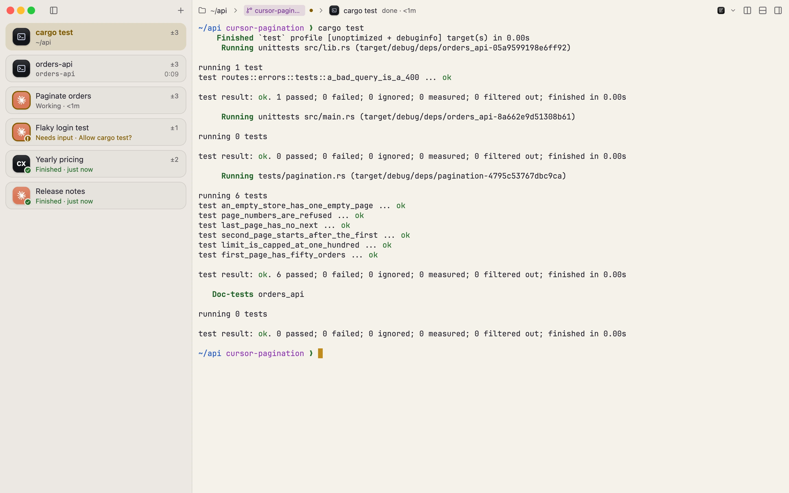
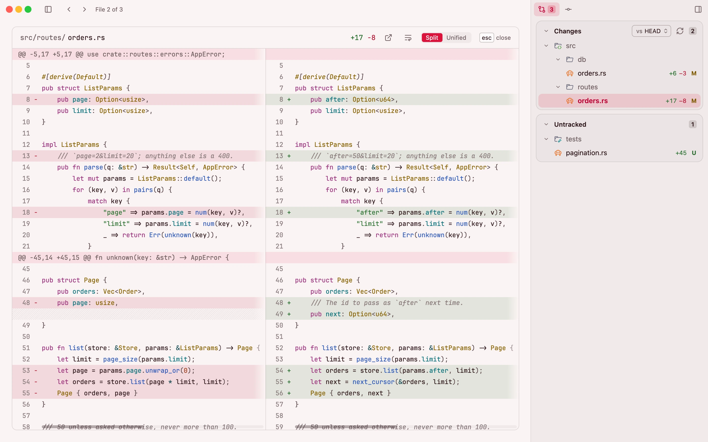

<p align="center">
  <picture>
    <source media="(prefers-color-scheme: dark)" srcset=".github/readme/icon-dark.png">
    
  </picture>
</p>

<h1 align="center">Wormhole</h1>

<p align="center">
  A fast terminal for the Mac that keeps all your terminals in one window.<br>
  <a href="https://getwormhole.app">Website</a> ·
  <a href="https://getwormhole.app/download">Download</a> ·
  <a href="https://getwormhole.app/features">Features</a> ·
  <a href="CHANGELOG.md">Changelog</a>
</p>

<p align="center">
  <picture>
    <source media="(prefers-color-scheme: dark)" srcset=".github/readme/overview-dark.webp">
    
  </picture>
</p>

A server, a build, a few shells, an agent or two: by the afternoon there are a dozen terminals
open, and in a row of tabs they all look the same.

In Wormhole every terminal is a row in a sidebar. You name them, group them, split them side by
side, and they are where you left them when you open the app again. Each row says what is going
on in it, so you can tell which one is still building and which one is waiting for you. Next to
the terminal are its git changes and history.

## What you get

- **A sidebar instead of tabs.** Group terminals, name them, color them, jump to one with
  ⌘1 to ⌘9. If you prefer tabs along the top, that's a setting.
- **Splits.** ⌘D keeps several terminals on screen together.
- **Quit and come back.** Windows, folders and each terminal's recent output are there when
  you open Wormhole again.
- **A complete terminal.** Command blocks with exit codes and timings, inline images
  (kitty, iTerm2, Sixel), search, a minimap, and themes: Ghostty, iTerm2 and Alacritty
  themes import, and the Theme Studio edits every color.
- **Git next to the terminal.** Changed files as a list or a tree, syntax-highlighted
  diffs side by side or inline, a comparison with any branch, and the branch's history.
- **Worktrees and profiles.** Open a terminal in a git worktree of its own, and keep Work
  and Private apart: each profile has its own terminals, theme and git identity.
- **Status for coding agents.** Claude Code, Codex, Gemini CLI, Cursor Agent and others
  show in their row whether they are working, finished or waiting for you, with the
  question they asked. Notifications, the Dock badge, a menu bar item and a quick panel
  let you answer without switching apps.

<p align="center">
  <picture>
    <source media="(prefers-color-scheme: dark)" srcset=".github/readme/diff-dark.webp">
    
  </picture>
</p>

Everything is on the keyboard: ⇧⌘P opens the command palette and ⌥⌘/ lists every shortcut,
as does [the website](https://getwormhole.app/shortcuts).

## How it's built

Wormhole is written in Rust and drawn with
[GPUI](https://github.com/zed-industries/zed/tree/main/crates/gpui), the UI framework of
the Zed editor. The terminal engine, [wormhole-vt](https://github.com/wormhole-terminal/wormhole-vt),
is Wormhole's own: written from the specifications and published separately under the MIT
license. How it compares with Ghostty, kitty, WezTerm, iTerm2, Alacritty and Terminal.app,
including where they're ahead, is on the
[compatibility page](https://getwormhole.app/compatibility).

## Install

Wormhole needs macOS 14 or later and runs on Apple silicon and Intel.
[Download it](https://getwormhole.app/download), or install it with Homebrew:

```sh
brew install --cask wormhole-terminal/tap/wormhole-terminal
```

## Build from source

You need macOS 14 or later, Rust (the version is pinned in `rust-toolchain.toml`) and the
Xcode command line tools.

```sh
cargo run --release
```

For development:

```sh
scripts/dev.sh            # rebuild on changes
scripts/check.sh          # run checks for the changed files
cargo test -p wormhole-core
```

The app lives in `crates/wormhole`; configuration, storage, git and agent integrations
live in `crates/wormhole-core`. See [CONTRIBUTING.md](CONTRIBUTING.md) for the checks,
the tests and how we write commits.

## Privacy

Wormhole has no analytics, no telemetry, no crash reporting, no account and no ID, and your settings
and terminal output stay on your Mac.

The one request Wormhole itself makes is the update check. It asks Wormhole's download server for the
newest version and says the app's name and its own version (`Wormhole-Updater/1.7.0`), nothing else;
the server sends it on to GitHub, where the files are. A test in
[`update/tests.rs`](crates/wormhole-core/src/update/tests.rs) lists every header a check carries.
The download server counts the checks it gets by version and the website's downloads, and stores no
IP address: its code is in [tools/feed-counter](tools/feed-counter). GitHub sees your IP address,
as with any download. Settings → Updates → Privacy shows the header your copy sends.

Versions 1.4 to 1.6 could say more with a check (the update channel, the chip, the macOS version, and
whether it was the day's or the month's first), with a switch to turn that off. That is gone.

The pull request mark in a terminal's title row asks the GitHub CLI (`gh`), if you have it installed
and signed in, and only in a project you trust.

## Feedback

[Report a bug](https://github.com/wormhole-terminal/wormhole/issues/new/choose)
or use [Discussions](https://github.com/wormhole-terminal/wormhole/discussions)
for questions and ideas. Report security vulnerabilities privately through
[GitHub security advisories](https://github.com/wormhole-terminal/wormhole/security/advisories/new);
see [SECURITY.md](SECURITY.md).

## License

Wormhole is free software under the [GNU GPL v3.0 or later](LICENSE).
[wormhole-vt](https://github.com/wormhole-terminal/wormhole-vt) is MIT-licensed.
Bundled fonts, themes, icons and dependencies retain their own licenses; see
About → Licenses in the app.
