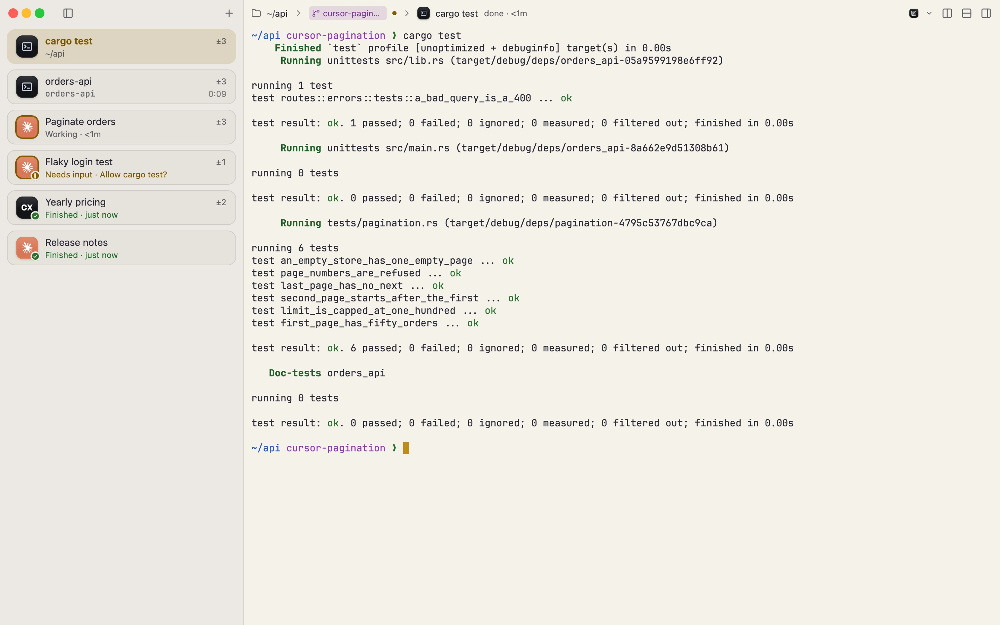
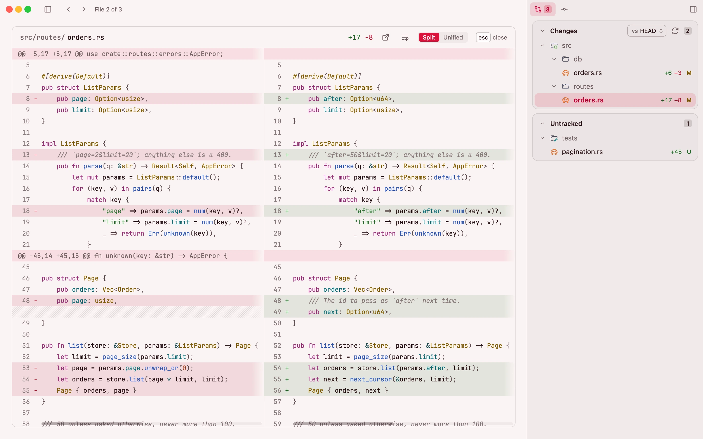

<p align="center">
  <picture>
    <source media="(prefers-color-scheme: dark)" srcset=".github/readme/icon-dark.png">
    
  </picture>
</p>

<h1 align="center">Wormhole</h1>

<p align="center">
  A fast, native Mac terminal with agent status, git and notes built in.<br>
  <a href="https://getwormhole.app">Website</a> ·
  <a href="https://getwormhole.app/download">Download</a> ·
  <a href="https://getwormhole.app/features">Features</a> ·
  <a href="CHANGELOG.md">Changelog</a>
</p>

<p align="center">
  <picture>
    <source media="(prefers-color-scheme: dark)" srcset=".github/readme/overview-dark.webp">
    
  </picture>
</p>

Four agents running, and one has been waiting on you for ten minutes. In a row of tabs
you find out by clicking through them.

In Wormhole every terminal is a row in a sidebar, and each row says what is going on there:
working, finished, or waiting for you, with the question the agent asked. A terminal with
nothing to report says nothing. Next to the terminal are its git changes and history, so
you can read what an agent did before you commit it, without leaving for another app.

It works with Claude Code, Codex, Gemini CLI, Cursor Agent and others, and it is just as
happy as a plain terminal with no agent at all.

## What you get

- **A sidebar instead of tabs.** Group terminals, name them, color them, jump to one with
  ⌘1 to ⌘9. A folded group still shows when one of its terminals needs you. If you prefer
  tabs along the top, that's a setting.
- **Status from the agents themselves.** Wormhole recognizes fifteen agents by the program
  running in the terminal. Eight of them, Claude Code and Codex among them, report their
  status directly once you install their hooks in Settings → Coding agents; for the rest,
  Wormhole goes by the output and the bell. Nothing is installed until you press Install.
- **The diff next to the terminal.** Changed files as a list or a tree, syntax-highlighted
  diffs side by side or inline, a comparison with any branch, and the branch's history.
- **Splits, worktrees, profiles.** Split with ⌘D, give an agent a git worktree of its
  own, and keep Work and Private apart: each profile has its own terminals, theme, git
  identity and Claude and Codex logins.
- **Away from the window.** Notifications, the Dock badge, a menu bar item and a quick
  panel with a global hotkey, so you can answer an agent without switching apps.
- **A terminal underneath.** Command blocks with exit codes and timings, inline images
  (kitty, iTerm2, Sixel), search, a minimap, and themes: Ghostty, iTerm2 and Alacritty
  themes import, and the Theme Studio edits every color.
- **Quit and come back.** Windows, folders and the last 2,000 lines of each terminal come
  back, encrypted on disk. Shells start fresh.

<p align="center">
  <picture>
    <source media="(prefers-color-scheme: dark)" srcset=".github/readme/diff-dark.webp">
    
  </picture>
</p>

Everything is on the keyboard: ⇧⌘P opens the command palette and ⌥⌘/ lists every shortcut,
as does [the website](https://getwormhole.app/shortcuts).

## How it's built

Wormhole is a native app written in Rust, drawn with
[GPUI](https://github.com/zed-industries/zed/tree/main/crates/gpui), the UI framework of
the Zed editor. It is not a web view. Wormhole has no AI of its own: no model, no API key,
no account. It runs the agents you already use.

The terminal engine, [wormhole-vt](https://github.com/wormhole-terminal/wormhole-vt), is
Wormhole's own: written from the specifications and published separately under the MIT
license. Agents print a lot and builds print more; the window keeps up. How it compares with Ghostty, kitty,
WezTerm, iTerm2, Alacritty and Terminal.app, including where they're ahead, is on the
[compatibility page](https://getwormhole.app/compatibility).

macOS only, for now. There is no Windows or Linux version.

## Install

Wormhole needs macOS 14 (Sonoma) or later and runs on Apple silicon and Intel.

Download the disk image from [getwormhole.app](https://getwormhole.app/download), drag
Wormhole into Applications and open it from there; it can't update itself from the disk
image or Downloads. It is signed with a Developer ID and notarized by Apple.

With Homebrew:

```sh
brew install --cask wormhole-terminal/tap/wormhole-terminal
```

Or build it yourself, below.

## Build from source

You need macOS 14 or later, Rust (the version is pinned in `rust-toolchain.toml`) and the
Xcode command line tools.

```sh
cargo run --release
```

For development:

```sh
scripts/dev.sh            # rebuild on changes
scripts/check.sh          # run checks for the changed files
cargo test -p wormhole-core
```

The app lives in `crates/wormhole`; configuration, storage, git and agent integrations
live in `crates/wormhole-core`. See [CONTRIBUTING.md](CONTRIBUTING.md) for the checks,
the tests and how we write commits.

## Privacy

Wormhole has no analytics, no crash reporting and no account, and your settings and terminal
output stay on your Mac. In 1.3 an update check sends the app version and nothing else.

From version 1.4, not released yet, a check also sends the update channel, Apple silicon or Intel
and the macOS major version, and the first check each day and each month is marked, so we can count
how many copies run. There is no ID, and the server keeps those counts, not your IP address: its code
is in [tools/feed-counter](tools/feed-counter). Counting starts a day after 1.4 first runs, and
Settings → Updates → Count this Mac anonymously shows what is sent and turns it off.

## Feedback

[Report a bug](https://github.com/wormhole-terminal/wormhole/issues/new/choose)
or use [Discussions](https://github.com/wormhole-terminal/wormhole/discussions)
for questions and ideas. Report security vulnerabilities privately through
[GitHub security advisories](https://github.com/wormhole-terminal/wormhole/security/advisories/new);
see [SECURITY.md](SECURITY.md).

## License

Wormhole is free software under the [GNU GPL v3.0 or later](LICENSE).
[wormhole-vt](https://github.com/wormhole-terminal/wormhole-vt) is MIT-licensed.
Bundled fonts, themes, icons and dependencies retain their own licenses; see
About → Licenses in the app.
